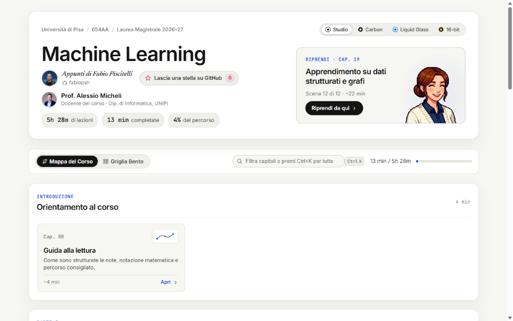
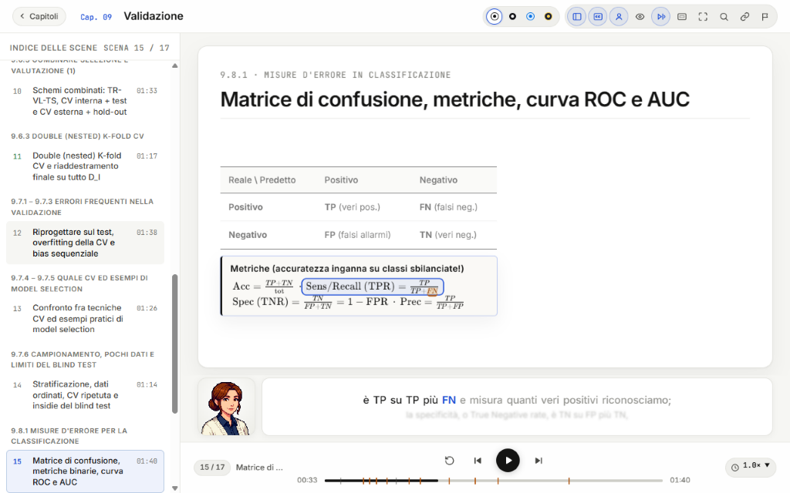
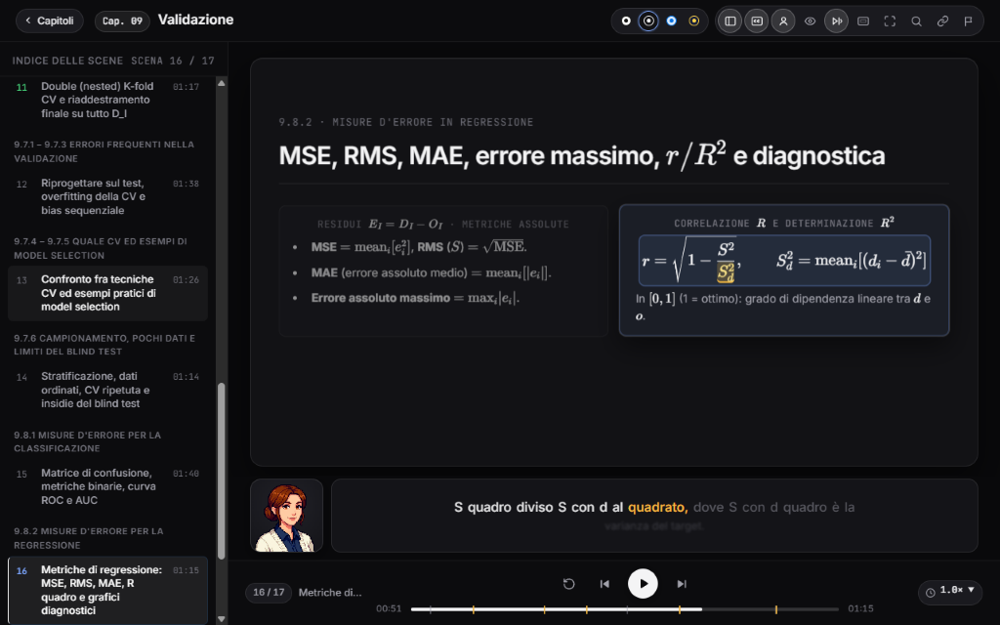
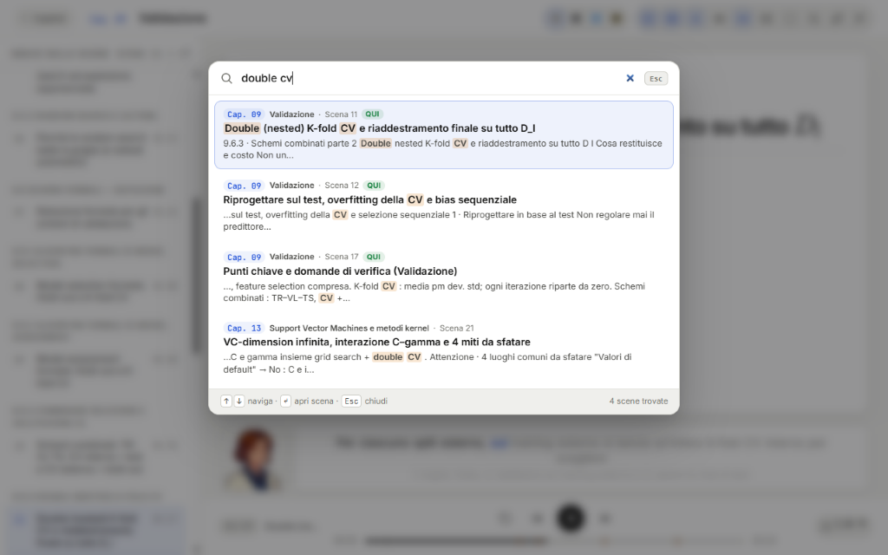

# Lectio Framework — Da PDF e Slide a Videolezioni Interattive (AI-First)

Trasforma qualsiasi raccolta di **appunti PDF, slide PowerPoint, sorgenti LaTeX o Markdown** in una web app statica di **videolezioni dinamiche sincronizzate alla voce** — pronta per GitHub Pages, senza backend e pensata per essere guidata da qualsiasi agente IA (**Claude Code, Antigravity, Codex, Cursor, Gemini CLI**).

👉 **Esempio reale in produzione** (20 capitoli, 231 scene, 5h 28m): [fabiopsh.github.io/machine-learning-video](https://fabiopsh.github.io/machine-learning-video/)



---

## Avvio in 3 passi (zero sbatti)

1. **Usa questo template** (o fai fork / clone):
   ```bash
   git clone https://github.com/fabiopsh/lectio-framework.git mio-corso
   cd mio-corso
   ```
2. **Metti i tuoi materiali in `sources/`** (PDF, slide `.pdf`/`.pptx`, `.tex`, `.md`).
3. **Apri la tua IA preferita** (Claude Code, Antigravity, Codex, Cursor, Gemini CLI) nella cartella e scrivi:
   > *"Iniziamo: guidami passo passo nella creazione delle videolezioni dal materiale in `sources/`."*

L'IA legge automaticamente [`AGENTS.md`](AGENTS.md) (più `CLAUDE.md`, `GEMINI.md`, `.cursorrules`), attiva la modalità **Caveman** per ridurre i token, ti aiuta a compilare `course.config.json`, ti guida nell'inserire la chiave API TTS in `.env` e orchestra l'intera pipeline.

---

## Cosa include già pronto all'uso

- **Player dinamico + Live-Sync voce ↔ formule KaTeX**: renderizza HTML, grafici SVG e matematica KaTeX nel browser illuminando in tempo reale box, singoli passi `<li>`, righe tabella e simboli esatti nelle formule, con sottotitoli parola per parola.
- **Tutor virtuale personalizzabile (default: Lia + voce `Kore`)**: avatar animato sincronizzato al labiale dai timestamp della voce — puoi tenere **Lia** così com'è, disattivarlo, oppure **creare il tuo tutor su misura** (scegliendo nome, voce Gemini/Edge diversa e generando un nuovo avatar con `generate_avatar.py`).
- **Ricerca globale `Ctrl+K`** su tutte le scene del corso (slide, formule e trascrizioni).
- **4 temi live**: `Studio` (chiaro editoriale), `Carbon` (scuro grafite), `Liquid Glass` e `16-bit`.
- **Progresso locale + continuità**: ore completate, Mappa del Corso + Griglia Bento, banner **Capitolo successivo** a fine lezione, pulsante **Segnala errore** (GitHub Issue pre-compilata).
- **Script deterministici a 0 token LLM**:
  - `ingest.py` — estrae testo e pagine da PDF/PPTX/LaTeX/Markdown;
  - `generate_avatar.py` — elenca voci TTS e genera/assembla un avatar tutor custom (6 frame + `course.config.json`);
  - `setup_tts.py` + `generate_batch.py` — TTS Gemini Batch (50% sconto, ~0,85 €/ora con budget cap) o Edge TTS gratuito;
  - `align_audio.py` — allineamento word-level (MMS_FA);
  - `npm run polish` — accorcia intro lunghe (`<= 4,5 s`) e aggiunge highlight granulari;
  - `npm run verify` — gate anti-regressione a **7 invarianti** su tutte le scene;
  - `build_pages.py` + GitHub Actions — pubblica automaticamente su GitHub Pages con URL puliti, `search-index.json`, cover OG PNG e audio MP3.

---

## Anteprime

| Tema **Studio** — sincronizzazione formule e Lia | Tema **Carbon** — focus formula atomo per atomo |
|---|---|
|  |  |



---

## Anteprima immediata della demo inclusa

Il repository include già un capitolo dimostrativo (`00-demo`) funzionante anche senza chiave API:

```bash
python videolezioni/scripts/serve.py
# Apri http://127.0.0.1:8080/
```

Per installare tutte le dipendenze della pipeline quando sei pronto a generare il tuo corso:

```bash
pip install -r requirements.txt
npm install
```

---

## Struttura

```text
├── course.config.json         # Unico file di configurazione del corso
├── AGENTS.md                  # Playbook IA (Caveman mode + wizard 5 passi)
├── CLAUDE.md / GEMINI.md      # Entry point per Claude Code, Antigravity, Codex, Cursor
├── sources/                   # Metti qui i tuoi PDF, slide, .tex o .md
├── docs/AI_AUTHORING_SPEC.md  # Specifica tecnica per generare lesson.json puliti
├── videolezioni/              # Web app statica, motore live-sync, avatar e scripts/
└── .github/workflows/         # Deploy automatico su GitHub Pages
```
